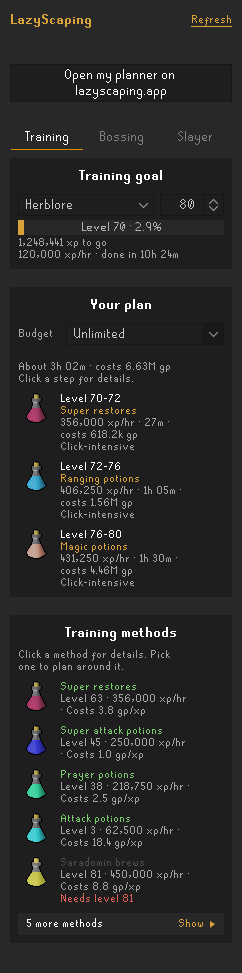
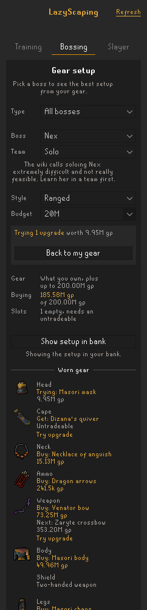
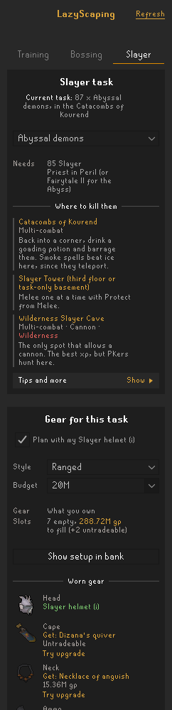

# LazyScaping

A RuneLite plugin for [LazyScaping](https://lazyscaping.app), the easy, cheap OSRS training and boss gear planner.

  

Found a bug or have an idea? [Open an issue](https://github.com/zaneowen/lazyscaping-runelite/issues).

## What it does

**One-click sync.** The *Open my planner on lazyscaping.app* button opens the site with your name, account type, membership, gear and quest unlocks already filled in, so you don't have to type them or paste a bank export. Your gear comes from your equipment, your inventory and your bank (open the bank once so the plugin can see it). The data travels after the `#` in the link, which your browser never sends to the server, and the site saves it in your browser like anything you set there yourself.

The side panel has three tabs.

**Training**
- **Training goal.** Pick a skill and a target level. The panel shows your progress since you set the goal, xp left, and, while you're training, your xp/hr and how long the goal will take (from RuneLite's XP Tracker).
- **Your plan.** The LazyScaping plan for your goal: which method to use at each level, with xp/hr, hours and cost, following your *Plan priority* setting and your budget. Click a step for the method's guide and materials.
- **Training methods.** Every method for the skill, with what it needs. Click one for its details and guide, and *Use this method* to plan around it.

**Bossing**
- **Gear setup.** Pick a boss, by name or narrowed to a type like *Slayer bosses* or *Raids*, to see the best setup from the gear you own: each worn slot's item with its picture, what to get next and its GE price, the packed inventory with switches, the special attack weapon and supplies, and how to get there. With a budget, it also buys the best upgrades you can afford (not for ironmen).
- **Solo or group.** Bosses with solo and group builds, like the raids, Nex and the God Wars generals, have a *Team* picker. The choice is saved per boss.
- **Equipment stats.** The worn gear's total bonuses, laid out like the in-game equipment stats screen, with the ones that matter for your style in gold.
- **Try upgrades.** Click *Try upgrade* under any slot to see the setup as if you had the next item, switches and inventory included. *Undo* drops one, and *Back to my gear* drops them all. The overview shows what they add in kills and gp an hour.
- **Pace and profit.** For bosses with a wiki money making guide, the overview estimates your kills and gp an hour at the pace your gear and levels allow.
- **Best upgrades.** The upgrades that do the most for their price, one per slot, with the gp an hour each adds and how it changes the stats that matter for your style.
- **Fight tips.** Click *Fight tips* for the fight's tips, which spellbook to be on and whether to use thralls. The *Style* picker marks the style your gear suits best.
- **Easy to scan.** Each section folds away by clicking its heading, and stays how you left it. Click any item's picture for its wiki page, and hover a stat for what it does.

**Slayer**
- **Your task.** The task from RuneLite's Slayer plugin, with kills left, is picked automatically; you can also pick any task. It shows the requirements, where to kill them and tips.
- **Gear for the task.** The same gear setup as the Bossing tab, planned for the task. *Plan with my Slayer helmet (i)* is ticked when you own one (any colour), and you can tick it yourself if yours is somewhere the plugin can't see.

**Show setup in bank.** Every gear setup can open a temporary *lazyscaping* bank tag with its items, laid out with the worn gear on top and the inventory as it's packed. If your bank is closed, it opens next time you open it.

**Your house and diaries.** Teleport to your house (or use its portal's *Home* option) and the plugin reads what it has, ticking the house settings for you. Open your portal nexus once so it can read the nexus's destinations too. It only reads a house you entered a way that leads to your own, never a friend's. You can also turn off *Read my house* and tick them yourself in the plugin's settings: a fairy ring, spirit tree, mounted teleports (Xeric's talisman, digsite pendant, amulet of glory, mythical cape), each teleport in your jewellery box, and every portal in your portal chamber or nexus. Gear setups then take a house teleport instead of the teleports these replace, freeing inventory space. A fairy ring or spirit tree replaces a boss's teleport when it gets you there (a fairy ring only once it needs no dramen staff, or the setup carries one anyway). Once you've done the elite Lumbridge & Draynor Diary (detected in game, or tick *Elite Lumbridge Diary*), fairy ring routes no longer pack a dramen staff.

**Budgets.** Each tab has a budget: a preset, an amount like `25m`, *Unlimited*, or *My coins* (the coins in your bank and inventory).

Goals, picked methods, bosses, Slayer tasks and budgets are saved per account.

**Live recommendations** (opt-in). The plan, methods and gear setups come from lazyscaping.app, so they need *Live recommendations* turned on in the plugin's settings.

## Privacy

With *Live recommendations* off, the plugin makes no network requests. Sync only opens a link in your browser.

With it on, the plugin sends what it needs to build your plan and gear setups to lazyscaping.app. The site uses it to answer the request and doesn't store it. Your RuneScape name and your bank are never sent: the gear you own is matched on your computer against the site's gear list, and only the matching LazyScaping gear ids are sent. Data goes in the request body over HTTPS, never in the URL.

### What's sent, and when

All requests go to `https://lazyscaping.app` and are made in the background, never on the game's thread.

| Request | When | What it sends |
|---|---|---|
| `GET /api/plugin/v1/catalog` | When the plugin starts with *Live recommendations* on, or when you turn it on | Nothing. It fetches the site's gear names, bosses and Slayer tasks, so new gear is recognised without a plugin update. |
| `POST /api/plugin/v1/plan` | When you log in, change your goal, method, *Plan priority* or training budget, gain a level, or click *Refresh* | Goal skill, its xp and target level; all skill levels; members and ironman flags; quest unlocks that open training methods; plan priority; training budget in gp; picked method. |
| `POST /api/plugin/v1/gear` | When you log in, pick a boss, Slayer task or style, change your gear budget or house settings, get or lose gear (at most once a minute), or click *Refresh* | The boss or task and style; all skill levels; LazyScaping ids of the gear you own; members and ironman flags; gear budget in gp; whether the elite Lumbridge Diary is done; the house teleports you tick. |
| `GET` item pictures | When a setup shows an untradeable item | Nothing. Pictures of tradeable items come from RuneLite. |

The *Open my planner on lazyscaping.app* button is separate: it opens a link in your browser with your name, account type, goal, gear and quest unlocks after the `#`, which browsers don't send to the server. It works with *Live recommendations* off.

## Development

Run a development client with the plugin loaded:

```
./gradlew run
```

To log in with a Jagex account, follow [Using Jagex Accounts](https://github.com/runelite/runelite/wiki/Using-Jagex-Accounts).

`src/main/resources/com/lazyscaping/gear-catalog.json` is a copy of https://lazyscaping.app/api/plugin/v1/catalog, bundled so sync works without any requests. Refresh it when the site adds gear or bosses.
